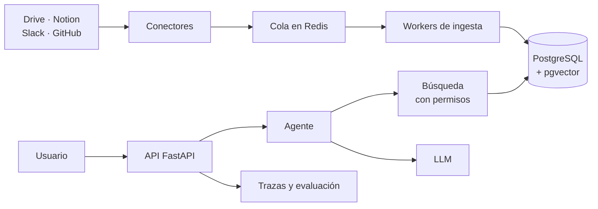

# Plan de proyecto: Buscador empresarial con IA y permisos

Sep 24, 2026 · @Someone

## Resumen del proyecto

El proyecto es un buscador empresarial con IA: conecta Google Drive, Notion, Slack y GitHub, indexa su contenido y responde preguntas con citas, respetando qué puede ver cada usuario. Encima corre un agente que decide en qué fuentes buscar y cruza la información.

Vale la pena porque lo difícil no es llamar a un LLM, sino el backend: permisos, sincronización incremental, aislamiento entre organizaciones y calidad de búsqueda medida. Es lo que muchas empresas están construyendo por dentro ahora mismo.

Al terminar, el proyecto demuestra:

- Un backend en Python listo para producción, con workers, colas y tests.
- Un RAG construido desde cero, con cada mejora justificada por métricas.
- Un sistema de permisos probado para que nunca filtre documentos.
- Un agente escrito a mano y luego migrado a LangGraph, con la comparación documentada.

Duración estimada: de 4 a 6 meses, dedicando 10 a 15 horas por semana. Pendiente: elegir un nombre para el proyecto.

## Objetivos de aprendizaje

Cada área se trabaja en hitos concretos, así que el progreso en el plan es también progreso en habilidades.

| Área | Habilidades | Hitos |
| --- | --- | --- |
| Backend | FastAPI, async/await, Pydantic, PostgreSQL, Docker, pytest | 2 |
| Procesamiento en segundo plano | Colas con Redis, workers, idempotencia, reintentos con backoff | 2, 4 |
| Integraciones | OAuth 2.0, webhooks, polling con cursores, límites de tasa | 4 |
| Datos y evaluación | Generación de datos sintéticos, sets de evaluación con verdad conocida | 1, 3 |
| Embeddings y RAG | Chunking, embeddings multilingües, pgvector, similitud coseno | 3 |
| Calidad de búsqueda | Búsqueda híbrida, full-text en español, reranking | 5 |
| Seguridad | Permisos en la recuperación, multi-tenant, prompt injection | 3, 7 |
| Agentes | Tool calling a mano, LangGraph, checkpoints | 6 |
| Operación | Trazas, evaluación continua, costos, despliegue | 7 |

## Principios de trabajo

La regla central: no integro código que no pueda explicar línea por línea.

- **Primero a mano.** Cada concepto nuevo lo escribo yo la primera vez; la IA acelera lo repetitivo después.
- **La IA como tutor, no como autor.** Escribo mi versión y le pido que la critique o me explique un error.
- **Sin frameworks al principio.** El RAG y el loop del agente van sin librerías antes de pasar a LangGraph.
- **Todo se mide.** Una mejora sin un número de antes y después no cuenta como mejora.
- **Decisiones por escrito.** Cada decisión importante va en un ADR corto en `docs/decisions/`: contexto, opciones y elección.
- **Punta a punta primero.** Una versión fea que funcione completa antes de profundizar en cualquier parte.
- **Señal de alarma.** Si algo falla y mi único recurso es pegarle el error a la IA, me detengo hasta entenderlo.

## Arquitectura y stack

El sistema tiene dos caminos: la ingesta, que corre en segundo plano, y la consulta, que responde al usuario en tiempo real.



Los permisos viven junto a los chunks en PostgreSQL, así que el filtro se aplica dentro de la misma búsqueda.

| Capa | Tecnología | Por qué |
| --- | --- | --- |
| API | FastAPI + Pydantic | Async nativo, validación y documentación OpenAPI automáticas |
| Base de datos | PostgreSQL + pgvector | Datos, permisos, vectores y full-text en un solo lugar |
| ORM y migraciones | SQLAlchemy 2 + Alembic | Estándar en el ecosistema Python |
| Colas y workers | Redis + arq (o Celery) | arq es async y simple; Celery si hace falta más control |
| Embeddings | Modelo multilingüe vía API o sentence-transformers | Buen desempeño en español; se comparan al menos dos |
| LLM | SDK directo de Anthropic u OpenAI | Tool calling a mano antes de cualquier framework |
| Agentes | LangGraph, desde el hito 6 | Estado, checkpoints y human-in-the-loop |
| Observabilidad | Langfuse + logs estructurados | Traza y costo de cada consulta |
| Tests | pytest + testcontainers | PostgreSQL y Redis reales en los tests |
| Entorno | uv, ruff, mypy, Docker Compose | Dependencias rápidas y el mismo entorno en local y en producción |

Tablas principales del modelo de datos: `tenants`, `users`, `groups`, `group_members`, `sources`, `documents`, `document_permissions`, `chunks`, `sync_cursors` e `ingestion_jobs`.

## La empresa ficticia, los datos y las conexiones

Las conexiones son reales; los datos no necesitan serlo. Se usan cuentas gratuitas propias con APIs reales, llenas con datos públicos y sintéticos.

### La empresa

Una empresa SaaS ficticia de unos 30 empleados, con cinco departamentos: Ingeniería, Producto, Ventas, RRHH y Finanzas. Los grupos de permisos son uno por departamento, más "Toda la empresa" y "Dirección". Pendiente: nombre y descripción de la empresa.

### Cuentas que hay que crear

- [ ] Workspace gratuito de Slack.
- [ ] Organización gratuita en GitHub con 2 o 3 repositorios, al menos uno privado.
- [ ] Workspace gratuito de Notion.
- [ ] 3 o 4 cuentas de Google que hagan de empleados, con documentos compartidos de forma selectiva.
- [ ] Proyecto en Google Cloud con la API de Drive habilitada y OAuth en modo de prueba.

Las funciones empresariales de pago, como grupos de dominio o delegación administrativa, se modelan en el sistema de permisos propio. Esa limitación se documenta en un ADR.

### Fuentes de datos

| Fuente | Tipo | Qué aporta |
| --- | --- | --- |
| Handbook público de GitLab | Real, público | Miles de páginas de políticas y procesos internos reales |
| Issues y discusiones de un proyecto open source grande | Real, público | Conversaciones técnicas desordenadas, como las de un equipo real |
| Corpus de correos de Enron | Real, público | Correo corporativo auténtico |
| Corpus sintético generado con un LLM | Sintético, en español | Permisos controlados y verdad conocida para evaluar |

Antes de republicar contenido de cualquier fuente pública, se revisa su licencia.

### Trampas que se plantan en el corpus sintético

- Políticas que se contradicen entre versiones, como vacaciones 2024 frente a 2025.
- Documentos obsoletos que no están marcados como tales.
- Respuestas repartidas entre un hilo de Slack y una página de Notion.
- Documentos confidenciales, como salarios o evaluaciones, que solo ve RRHH.
- Un documento con un prompt injection escondido.

### Contrato común de los conectores

Cada fuente implementa la misma interfaz. Los cambios se detectan con webhooks donde existan, o con polling y cursores donde no.

```python
class Connector(Protocol):
    async def authenticate(self) -> None: ...
    async def list_documents(self, cursor: str | None) -> Page[DocumentRef]: ...
    async def fetch_content(self, ref: DocumentRef) -> DocumentContent: ...
    async def fetch_permissions(self, ref: DocumentRef) -> list[Principal]: ...
    async def get_changes(self, cursor: str) -> ChangeSet: ...
```

Orden de construcción: conector falso en memoria, GitHub, Google Drive y, por último, Slack o Notion. El conector falso simula ediciones, borrados y cambios de permisos a demanda, para probar la sincronización sin depender de servicios externos.

## Cómo empezar: semana 0

La primera semana deja listo el entorno y una base que funciona, sin tocar IA todavía.

- [ ] Crear el repositorio público con README inicial, licencia y `.gitignore`.
- [ ] Definir la estructura: `app/`, `workers/`, `connectors/`, `tests/`, `evals/` y `docs/decisions/`.
- [ ] Configurar uv, ruff, mypy y pre-commit.
- [ ] Levantar PostgreSQL con pgvector y Redis con Docker Compose.
- [ ] Crear un endpoint `/health` en FastAPI con un test que pase.
- [ ] Configurar CI en GitHub Actions que corra lint y tests en cada push.
- [ ] Escribir el primer ADR: por qué este proyecto y este stack.
- [ ] Definir el nombre y la descripción de la empresa ficticia.
- [ ] Publicar el post de arranque en LinkedIn.

Si hace falta repasar antes: async/await en Python, SQL con joins e índices, y los flujos básicos de OAuth 2.0.

## Plan de hitos

Son siete hitos en orden; cada uno deja algo funcionando que se puede mostrar.

### Hito 1 — Empresa ficticia y datos (1–2 semanas)

Objetivo: un corpus realista, con permisos y con verdad conocida para evaluar.

- [ ] Definir departamentos, empleados, proyectos y grupos de permisos en un archivo de configuración.
- [ ] Escribir el script que genera documentos sintéticos en español, coherentes en personas, fechas y proyectos.
- [ ] Plantar las trampas: contradicciones, documentos obsoletos, información repartida, confidenciales y prompt injection.
- [ ] Descargar y limpiar una muestra de las fuentes públicas.
- [ ] Armar el set de evaluación v1: 50 preguntas con documento esperado, respuesta esperada y quién puede verlo.

Entregable: corpus versionado y `evals/dataset_v1.jsonl`.

### Hito 2 — Backend base (2–3 semanas)

Objetivo: ingesta confiable de documentos, con el modelo de datos y los permisos listos.

- [ ] Crear el modelo de datos y las migraciones con Alembic.
- [ ] Definir el contrato `Connector` y el conector falso en memoria.
- [ ] Construir el pipeline de ingesta idempotente con workers y cola en Redis.
- [ ] Añadir autenticación de usuarios de la app y la API para consultar documentos.
- [ ] Escribir tests de sincronización deterministas con el conector falso.

Entregable: el corpus completo se ingiere dos veces seguidas sin duplicados.

### Hito 3 — RAG con permisos, a mano (2–3 semanas)

Objetivo: responder preguntas con citas sin filtrar nunca un documento sin permiso.

- [ ] Implementar chunking v1 y embeddings; buscar primero con numpy y luego con pgvector.
- [ ] Filtrar por permisos antes de la búsqueda, no después.
- [ ] Crear el endpoint `/ask`, que responde con citas usando el SDK directo del LLM.
- [ ] Construir el arnés de evaluación: recall@k, MRR y fidelidad de citas.
- [ ] Escribir tests de fuga: para cada usuario, ningún chunk de documentos que no puede ver.

Entregable: primer valor de recall@5 publicado en el README.

### Hito 4 — Conectores reales (3–4 semanas)

Objetivo: sincronizar fuentes reales de forma incremental y resistente a fallos.

- [ ] Conector de GitHub: repositorios, issues y pull requests, con webhooks.
- [ ] Conector de Google Drive: OAuth, detección de cambios y permisos compartidos.
- [ ] Conector de Slack o de Notion, uno de los dos.
- [ ] Sincronización incremental de ediciones, borrados, documentos movidos y permisos que cambian.
- [ ] Reintentos con backoff, respeto de límites de tasa y renovación de tokens OAuth.

Entregable: un cambio de permisos en Drive se refleja en la búsqueda dentro de un tiempo meta. Pendiente: fijar esa meta en minutos.

### Hito 5 — Calidad de búsqueda (2–3 semanas)

Objetivo: mejorar la recuperación con experimentos medidos.

- [ ] Implementar búsqueda híbrida: full-text de PostgreSQL en español más vectores.
- [ ] Añadir reranking.
- [ ] Ajustar el chunking por tipo de fuente: hilos de Slack, documentos e issues.
- [ ] Comparar al menos dos modelos de embeddings en español.
- [ ] Manejar información contradictoria u obsoleta usando fechas y versiones.

Entregable: tabla de experimentos con recall@5, latencia y costo por configuración.

### Hito 6 — Agente (2–3 semanas)

Objetivo: un agente que responde preguntas que requieren cruzar varias fuentes.

- [ ] Escribir el loop del agente a mano, con herramientas para buscar por fuente, abrir un documento y ver cambios recientes.
- [ ] Añadir límite de pasos, manejo de errores de herramientas y presupuesto de tokens.
- [ ] Evaluar con preguntas que requieren cruzar dos o más fuentes.
- [ ] Migrar el agente a LangGraph con checkpoints.
- [ ] Documentar la comparación: qué se gana y qué se pierde con el framework.

Entregable: agente que responde preguntas multi-fuente con citas.

### Hito 7 — Producción (2–3 semanas)

Objetivo: un sistema desplegado, observable y seguro.

- [ ] Multi-tenant con aislamiento probado entre organizaciones.
- [ ] Trazas de cada consulta en Langfuse y costo por consulta.
- [ ] Caching de embeddings y respuestas.
- [ ] Defensa contra prompt injection desde documentos indexados.
- [ ] Evaluación automática en CI que falla si bajan el recall o la fidelidad.
- [ ] Despliegue público con una demo sobre los datos ficticios.

Entregable: demo pública y README final con arquitectura, decisiones y métricas.

## Evaluación y métricas

La única meta fija desde el inicio es cero fugas de permisos; las demás se fijan tras medir la línea base en el hito 3.

| Métrica | Qué mide | Desde el hito |
| --- | --- | --- |
| Fugas de permisos | Chunks recuperados de documentos a los que el usuario no tiene acceso | 3 |
| Recall@k | Si el documento correcto aparece entre los k primeros resultados | 3 |
| MRR | Qué tan arriba aparece el documento correcto | 3 |
| Fidelidad de citas | Si la fuente citada respalda la afirmación; LLM como juez más revisión manual de una muestra | 3 |
| Latencia p50 y p95 | Tiempo de respuesta de `/ask` | 3 |
| Costo por consulta | Tokens usados por su precio | 3 |
| Frescura de sincronización | Tiempo entre un cambio en la fuente y su reflejo en la búsqueda | 4 |
| Éxito multi-fuente | Preguntas que requieren cruzar fuentes respondidas correctamente | 6 |

Reglas de evaluación:

- El set de evaluación se versiona y se amplía en cada hito.
- Se separa un subconjunto de desarrollo y uno de prueba; los ajustes se hacen solo con el de desarrollo.
- Cada experimento se registra en `evals/results/` con la configuración, la fecha y los resultados.

## Publicaciones en LinkedIn

Hay una publicación por hito, más la de arranque: ocho en total.

| Cuándo | Tema |
| --- | --- |
| Semana 0 | Qué voy a construir y por qué |
| Hito 1 | Cómo generar una empresa ficticia coherente para probar un buscador |
| Hito 2 | La arquitectura del sistema y por qué la elegí |
| Hito 3 | Cómo evitar que un RAG muestre lo que no debe |
| Hito 4 | Lo que aprendí sincronizando APIs de terceros |
| Hito 5 | La búsqueda antes y después, con números |
| Hito 6 | Mi agente escrito a mano frente a LangGraph |
| Hito 7 | Retrospectiva del proyecto completo |

Cómo escribirlas:

- Contar una decisión o un fallo concreto, con números de antes y después.
- Incluir siempre el enlace al repositorio y un diagrama o captura.
- Evitar el formato "hoy aprendí X"; mostrar el problema, lo que se probó y lo que funcionó.
- Si un hito tarda el doble de lo previsto, eso también es contenido.

## Seguimiento

El estado de cada hito se actualiza en esta tabla; las tareas se marcan en sus checklists.

| Hito | Duración estimada | Estado | Fecha de cierre |
| --- | --- | --- | --- |
| Semana 0 — Preparación | 1 semana | No iniciado |  |
| Hito 1 — Empresa ficticia y datos | 1–2 semanas | No iniciado |  |
| Hito 2 — Backend base | 2–3 semanas | No iniciado |  |
| Hito 3 — RAG con permisos | 2–3 semanas | No iniciado |  |
| Hito 4 — Conectores reales | 3–4 semanas | No iniciado |  |
| Hito 5 — Calidad de búsqueda | 2–3 semanas | No iniciado |  |
| Hito 6 — Agente | 2–3 semanas | No iniciado |  |
| Hito 7 — Producción | 2–3 semanas | No iniciado |  |

### Bitácora semanal

Una fila por semana; la más reciente arriba.

| Semana | Horas | Avances | Bloqueos | Siguiente paso |
| --- | --- | --- | --- | --- |
| Semana 0 |  |  |  |  |

## Riesgos y mitigación

El mayor riesgo es abandonar a la mitad; casi todas las mitigaciones apuntan a tener algo funcionando pronto.

| Riesgo | Mitigación |
| --- | --- |
| Abandonar el proyecto a la mitad | Versión fea de punta a punta cuanto antes; cada hito deja algo mostrable |
| Atascarse con APIs de terceros | Conector falso primero; GitHub antes que Drive |
| Delegar demasiado en la IA | Regla de la explicación; cada concepto se escribe a mano la primera vez |
| Costos de API | Presupuesto mensual, caching, modelos pequeños para evaluar y un corpus de prueba reducido |
| Sobreajustar al set de evaluación | Separar desarrollo y prueba; ampliar el set en cada hito |
| Alcance que crece sin control | Lista "para después" en el README; máximo tres conectores reales |
| Datos con licencia o privados | Solo datos públicos con licencia revisada, o sintéticos; nada real de empresas |

## Recursos

Lecturas y herramientas de referencia, ordenadas por el hito en que se usan.

| Recurso | Para qué sirve | Hito |
| --- | --- | --- |
| [Handbook público de GitLab](https://about.gitlab.com/handbook/) | Fuente de datos real: políticas y procesos internos | 1 |
| [Corpus de correos de Enron (CMU)](http://www.cs.cmu.edu/~enron/) | Fuente de datos real: correo corporativo | 1 |
| Designing Data-Intensive Applications, de Martin Kleppmann | Fundamentos de colas, consistencia y sincronización de datos | 2, 4 |
| [pgvector](https://github.com/pgvector/pgvector) | Búsqueda vectorial dentro de PostgreSQL | 3 |
| [Onyx](https://github.com/onyx-dot-app/onyx) | Buscador empresarial open source; leer sus conectores después de escribir los propios | 4 |
| [Building effective agents, de Anthropic](https://www.anthropic.com/research/building-effective-agents) | Cuándo usar un flujo fijo y cuándo un agente; patrones simples | 6 |
| [Documentación de LangGraph](https://docs.langchain.com/oss/python/langgraph/overview) | Grafos de estado, persistencia y checkpoints | 6 |
| [Langfuse](https://langfuse.com/docs) | Trazas, costos y evaluación de aplicaciones con LLM | 7 |

Onyx explica en su [página de conectores](https://onyx.app/connectors) por qué indexa por adelantado en lugar de consultar en vivo por MCP; vale la pena leerlo antes del hito 4.
